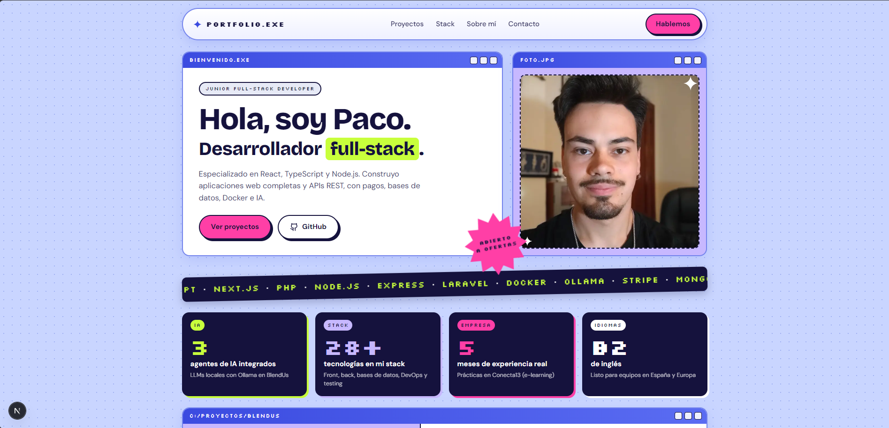

<div align="center">

# Portfolio.exe

**Portfolio personal de Francisco José Serrano Muñoz (Paco), desarrollador junior full-stack.**

Una web de una sola página con estética Y2K / escritorio retro, construida con Next.js, React y TypeScript.

<!-- TODO: cuando esté desplegado, descomenta y pon la URL real
**[Ver en vivo →](https://tu-dominio.com)**
-->





</div>

---

## Sobre el proyecto

Este repositorio contiene el código de mi portfolio. La idea era alejarme de la plantilla típica de portfolio y darle personalidad: cada sección es una "ventana" de un escritorio retro, con tipografía pixel, colores neón y sombras duras.

En la web encontrarás:

- **Proyectos destacados**: [BlendUs](https://github.com/fjsermun3103/BlendUs), una red social full-stack con agentes de IA (Ollama), pagos con Stripe y mensajería en tiempo real, y [MERN Calendar](https://github.com/fjsermun3103/MERN-calendar), un gestor de eventos con autenticación JWT.
- **Stack técnico**, agrupado por áreas: frontend, backend, bases de datos, DevOps, IA y testing.
- **Experiencia, formación, cursos e idiomas.**
- **Contacto** directo por email, GitHub y LinkedIn.

## Características

- **Diseño propio estilo Y2K**: ventanas, marquesina animada, sello de "abierto a ofertas" y capturas de proyecto en marcos de navegador que recorren la página al pasar el ratón.
- **Stats animados**: las cifras cuentan desde cero al entrar en pantalla, con `IntersectionObserver` y `requestAnimationFrame`, sin librerías.
- **Contenido separado de la interfaz**: todos los textos, enlaces y datos viven en [`src/data/portfolio.ts`](src/data/portfolio.ts). Actualizar el portfolio no exige tocar componentes.
- **Datos que no se desincronizan**: por ejemplo, el número de tecnologías de los stats se calcula a partir del propio stack.
- **Responsive**: se adapta a escritorio, tablet y móvil.
- **Accesible**: HTML semántico, textos alternativos, elementos decorativos ocultos a lectores de pantalla y respeto a `prefers-reduced-motion` (sin animaciones si el usuario las ha desactivado).
- **Rendimiento**: Server Components por defecto (solo los stats se ejecutan en el cliente), imágenes optimizadas con `next/image` y fuentes autoalojadas con `next/font`.
- **Sin dependencias de UI**: todo el estilo es CSS propio con variables, sin frameworks ni librerías de componentes.

## Stack

| Área | Tecnologías |
| --- | --- |
| Framework | [Next.js 16](https://nextjs.org) (App Router) |
| UI | React 19, TypeScript |
| Estilos | CSS puro con custom properties |
| Tipografías | Bricolage Grotesque, DM Sans y Silkscreen vía `next/font` |
| Calidad | ESLint (`eslint-config-next`) |

## Empezar

**Requisitos:** Node.js 20 o superior.

```bash
# Clonar el repositorio
git clone https://github.com/fjsermun3103/Portfolio.git
cd Portfolio

# Instalar dependencias
npm install

# Servidor de desarrollo en http://localhost:3000
npm run dev
```

### Scripts

| Comando | Descripción |
| --- | --- |
| `npm run dev` | Arranca el servidor de desarrollo |
| `npm run build` | Genera la build de producción |
| `npm run start` | Sirve la build de producción |
| `npm run lint` | Revisa el código con ESLint |

## Estructura

```
src/
├── app/
│   ├── layout.tsx       # Layout raíz, metadatos y fuentes
│   ├── page.tsx         # Página principal: compone todas las secciones
│   └── globals.css      # Sistema de diseño y estilos
├── components/          # Piezas reutilizables (Window, NavBar, Stats, Marquee…)
├── windows/             # Cada sección del portfolio como "ventana"
└── data/
    └── portfolio.ts     # Todo el contenido: textos, enlaces, proyectos, stack…
public/                  # Foto y capturas de los proyectos
```

## Personalizar el contenido

Casi cualquier cambio de contenido se hace en un solo archivo, [`src/data/portfolio.ts`](src/data/portfolio.ts):

| Quiero cambiar… | Edita |
| --- | --- |
| Enlaces y email | `links` |
| Cifras destacadas | `stats` |
| Proyectos | `blendus`, `mernCalendar` |
| Tecnologías | `stackGroups` y `marqueeItems` |
| Sobre mí, prácticas, estudios | `about`, `internship`, `studies` |
| Cursos e idiomas | `courses`, `languages` |

Los colores del diseño se definen como variables en `:root` al principio de [`src/app/globals.css`](src/app/globals.css).

## Contacto

¿Buscas un desarrollador junior full-stack? Estoy disponible en remoto, en híbrido o con reubicación.

- **Email:** [fsermun3103@gmail.com](mailto:fsermun3103@gmail.com)
- **LinkedIn:** [linkedin.com/in/fsermun3103](https://www.linkedin.com/in/fsermun3103/)
- **GitHub:** [@fjsermun3103](https://github.com/fjsermun3103)

---

<div align="center">
<sub>Diseñado y desarrollado por Francisco José Serrano Muñoz · 2026</sub>
</div>
